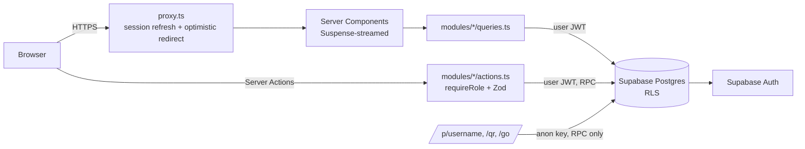

# Architecture

## Overview

A **modular monolith**: one Next.js 16 application (App Router, React 19, Cache Components, Partial Prefetching)
backed by Supabase Postgres. Authorization lives in the database (RLS + `SECURITY DEFINER` functions); the app adds a
second, server-side layer of checks and validation.

## Layers

| Layer          | Location                          | Responsibility                                                      |
| -------------- | --------------------------------- | ------------------------------------------------------------------- |
| Routing / UI   | `src/app`, `src/components`       | Pages, layouts, presentation. No business rules.                    |
| Domain modules | `src/modules/<domain>`            | Zod schemas, server-only queries, Server Actions, pure helpers      |
| Infrastructure | `src/lib/supabase`, `src/lib/env` | Supabase clients, env validation, generated DB types                |
| Database       | `supabase/migrations`             | Tables, constraints, RLS, state-machine functions, audit log        |

## Domain modules (Phase 1)

| Module           | Contents                                                                 |
| ---------------- | ------------------------------------------------------------------------ |
| `identity`       | Roles metadata, session DAL (`getCurrentUser`, `requireRole`), auth actions, onboarding |
| `hospitality`    | Profile + link schemas/queries/actions                                   |
| `public-profile` | Public profile read, offer ordering, QR generation, redirect resolution  |
| `advertisers`    | Business profile, campaigns, invitations                                 |
| `partnerships`   | Professional-side partnership actions, blocks, UI state machine          |
| `connections`    | Customer ↔ professional connections and consent                          |
| `shared`         | Action result type + DB error mapping, money utils, safe redirect         |

Planned modules (not yet created): organizations admin, messaging, analytics, referrals, financial ledger,
notifications, loyalty, administration. Each will follow the same layout.

## Auth & sessions

- Supabase Auth with email + password. `@supabase/ssr` stores the session in HTTP-only cookies.
- `src/proxy.ts` (Next 16's renamed middleware) refreshes the session with `getClaims()` and redirects signed-out
  users away from `/dashboard` and `/onboarding`. It is **not** authorization.
- `getCurrentUser()` verifies the JWT (`getClaims`) and loads roles through RLS; cached per request.
- Email confirmation lands on `/auth/confirm` (supports PKCE `code` and `token_hash`).

## Rendering

Cache Components is enabled. Static shells (layout chrome, headings) prerender; anything that reads cookies or
`params` streams inside `<Suspense>`. Public profiles call `connection()` to always render fresh so declines and
blocks are reflected immediately; caching with tag invalidation is a later optimization.

## Routes

| Route                                         | Access                         |
| --------------------------------------------- | ------------------------------ |
| `/`                                           | Public marketing               |
| `/login`, `/signup`, `/auth/confirm`          | Public auth                    |
| `/onboarding`                                 | Signed in                      |
| `/dashboard`                                  | Signed in → role redirect      |
| `/dashboard/hospitality/*`                    | `hospitality` role             |
| `/dashboard/customer`                         | `customer` role                |
| `/dashboard/advertiser/*`                     | `advertiser` role              |
| `/dashboard/establishment`                    | `establishment` role           |
| `/dashboard/admin`                            | `admin` role                   |
| `/p/[username]`, `/p/[username]/qr`           | Public (published profiles)    |
| `/go/[partnershipId]`                         | Public controlled redirect     |

## Evolving the architecture

Extract services only if scale demands it. Natural seams: analytics ingestion (high write volume), payouts/ledger
(compliance isolation), messaging (realtime). Background work (reports, payouts) will use Trigger.dev.
