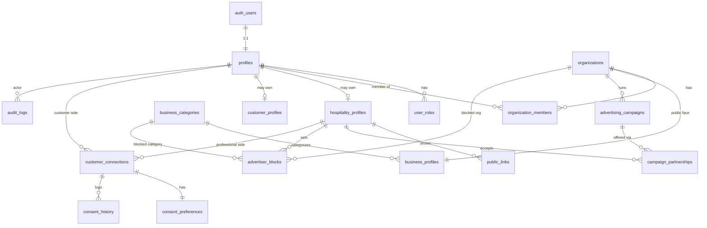
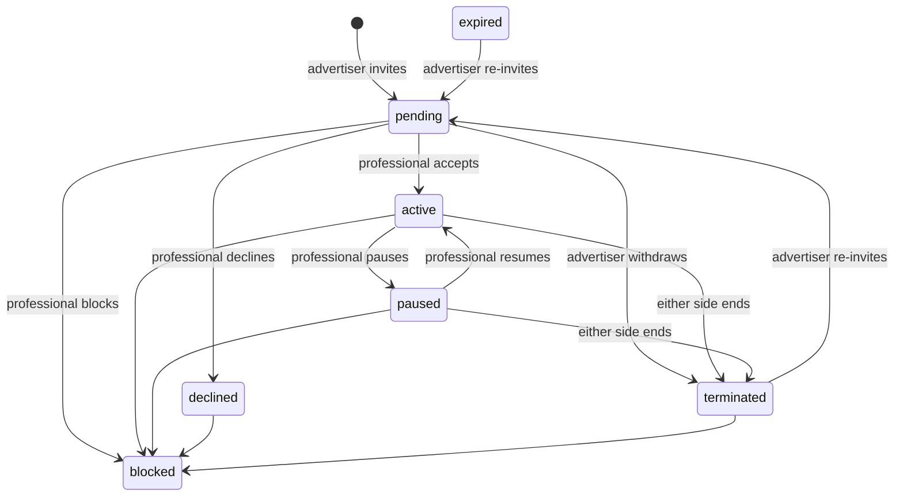

# Database schema

Source of truth: `supabase/migrations/*.sql` (applied in order). Types: `src/lib/supabase/database.types.ts`.

## Conventions

- UUID primary keys (`gen_random_uuid()`), `timestamptz` `created_at`/`updated_at` (trigger-maintained).
- Check constraints mirror Zod validation (usernames, https URLs, lengths, non-negative money).
- Money in integer minor units (`*_minor`), percentages in basis points (`*_bps`), ISO currency codes.
- RLS enabled on every table. Column-level `GRANT`s restrict which columns clients may write.
- State transitions only via `SECURITY DEFINER` functions in `public` (callable RPCs).
- Policy helpers in `private` (not exposed through the Data API).

## Phase 1 entity relationship diagram

## Tables

| Table                  | Purpose                                                   | Client writes                                         |
| ---------------------- | --------------------------------------------------------- | ----------------------------------------------------- |
| `profiles`             | One row per auth user (auto-created by trigger)           | `display_name` only                                   |
| `user_roles`           | Multi-role membership                                     | None (via `claim_role`)                               |
| `organizations`        | Advertiser / establishment tenants                        | `name` (owners/admins)                                |
| `organization_members` | Membership + `owner/admin/member`                         | None (via functions)                                  |
| `business_categories`  | Reference data (21 seeded)                                | None                                                  |
| `business_profiles`    | Public business info; `verification_status`               | Descriptive columns; never `verification_status`      |
| `hospitality_profiles` | Username, display name, bio, avatar URL, workplace, published | Owner, requires `hospitality` role                |
| `public_links`         | Social/tip/personal/booking links (https, max 25)         | Owner                                                 |
| `advertising_campaigns`| Offer, destination, market, compensation, budget, status  | Org owners/admins; delete only drafts                 |
| `campaign_partnerships`| Campaign ↔ professional, state machine                    | None (via functions)                                  |
| `advertiser_blocks`    | Org or category blocks                                    | Delete own (unblock); create via `block_advertiser`   |
| `customer_profiles`    | Customer display name, local/visitor                      | Owner, requires `customer` role                       |
| `customer_connections` | Customer ↔ professional connection state                  | None (via functions)                                  |
| `consent_preferences`  | Five boolean scopes, default false                        | None (via `set_consent`)                              |
| `consent_history`      | Append-only consent audit                                 | None                                                  |
| `audit_logs`           | Append-only action log                                    | None; admins read                                     |

## Functions (RPC)

| Function                                 | Caller                 | Notes                                                    |
| ---------------------------------------- | ---------------------- | -------------------------------------------------------- |
| `claim_role(role, confirm_adult)`        | authenticated          | Only customer/hospitality/advertiser; 18+ attestation    |
| `create_advertiser_organization(...)`    | advertiser             | Org + owner membership + business profile; max 5/user    |
| `invite_to_campaign(campaign, username)` | org owner/admin        | Rejects blocked/declined; 50 invites/org/24h             |
| `professional_update_partnership(id, action)` | profile owner     | accept, decline, pause, resume, terminate, block         |
| `advertiser_update_partnership(id, action)`   | org owner/admin   | withdraw (pending), terminate                            |
| `block_advertiser(org?, category?)`      | professional           | Blocks + sets matching partnerships to `blocked`         |
| `request_connection(username)`           | customer               | 30 requests/24h; declined/blocked → generic error        |
| `professional_update_connection(id, action)` | profile owner      | accept, decline, disconnect, block                       |
| `customer_update_connection(id, action)` | customer               | cancel, disconnect, block                                |
| `set_consent(connection, scope, granted)`| customer               | Grant requires accepted connection; writes history       |
| `list_professional_connections()`        | professional           | Display name + granted scopes only                       |
| `get_public_profile(username)`           | anon, authenticated    | Allow-listed fields; visible offers only                 |
| `resolve_offer_redirect(partnership)`    | anon, authenticated    | Destination only while offer is publicly visible         |

Internal (not callable by clients): `write_audit`, `revoke_all_consent`, `is_advertiser_blocked`, `handle_new_user`,
`enforce_public_link_limit`. Policy helpers in `private`: `has_role`, `is_admin`, `is_org_member`,
`owns_hospitality_profile`, `has_partnership_with_campaign`, `campaign_org`.

## Partnership state machine

`accepted` and `expired` are reserved for future contract/approval steps and time-boxed sponsorships.
`declined` and `blocked` cannot be re-invited.

## Connection state machine

pending → accepted | declined (professional) · pending → disconnected (customer cancels) · accepted → disconnected
(either) · any → blocked (either; a customer block hides the row from the professional) · disconnected → pending
(customer re-requests). Declined/disconnected/blocked revoke all consent.

## Deferred tables (designed, not created)

`establishments`, `establishment_affiliations`, `customer_shared_preferences`, `customer_checkins`, `conversations`,
`conversation_participants`, `messages`, `message_reports`, `affiliate_links`, `referral_events`, `analytics_events`,
`leads`, `conversions`, `commission_rules`, `financial_ledger_entries`, `payouts`, `subscriptions`, `notifications`,
`notification_preferences`. Key decisions already made for them are in [DECISIONS.md](DECISIONS.md).

## Note on remote migration history

The dev project's migrations were applied through the Supabase connector, which records them under their names
(`identity`, `organizations`, …) with apply-time versions rather than the file timestamps. Before using
`supabase db push`, run `supabase migration repair` to align the history, or keep applying via the connector.
